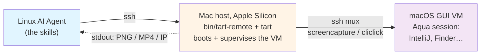

# A Real macOS Desktop for a Linux Agent: Driving Tart VMs over SSH with Agent Skills

**Date:** July 16, 2026  
**Author:** Eugene Petrenko  
**Tags:** ai-agents, ai-coding, tart, macos, testing, intellij, agent-skills

---

[![A real macOS desktop — Finder, Dock, wallpaper — captured over SSH from a
headless Tart VM][hero-img]][hero-img]

*The AI Agent that took this screenshot has never touched a Mac. It is running on Linux, it reached an Apple
Silicon Mac over SSH, booted a [Tart][tart] VM there, and captured a real macOS Aqua session — Finder, Dock,
wallpaper and all.*

In the [previous post][docker-post] we booted a full IntelliJ IDEA inside a Docker container — Xvfb for the
display, fluxbox to keep the windows still, ffmpeg recording, live video streamed into a browser tab
([watch it on YouTube][demo-video]). I mentioned that Docker limits us to Linux, and
that "solutions like tart to run virtual macOS" were left uncovered. That was the honest gap: if the thing
you need your Agent to test is *macOS itself* — Gatekeeper, the TCC consent prompts, Aqua window focus — a
Linux container will never show it to you.

I experimented with capturing a demo video with an AI Agent on macOS. We processed all the experience, and
condensed it into this post — the macOS half of the story. This time the deliverable is not a Kotlin test
harness — it is a set of [Agent Skills][repo]: plain-markdown instructions plus a small `bin/tart-remote`
orchestrator that any AI Agent on Linux can pick up to **boot, see, and drive a real macOS desktop over
SSH**. It is open source in [jonnyzzz/tart-skills][repo].

## The problem: a macOS GUI, and no Mac for the Agent

[Tart][tart] runs macOS and Linux virtual machines on Apple Silicon using Apple's `Virtualization.framework`
([tart.run][tart]). It is excellent — but it only runs on an Apple Silicon Mac.
In my setup, most of the agentic payload is running on Linux, and I decided to explore the approach
of connecting a Linux machine to a Mac VM, over SSH. The Agent side is not picky — we tested from Linux,
and the same commands work from a Docker container or from another Mac. The one hard requirement is the
VM host: that is always an Apple Silicon Mac. With this post I want to show what is possible.

There is a second problem, softer but just as real. The lessons from the Docker post lived *inside* one
project's harness. This time we wanted the knowledge to travel — between Claude Code, Codex, Gemini, and
whatever comes next. Markdown skills plus a thin CLI move between Agents in a way a test module never will.

## The two SSH hops

The whole design is one clean seam. The Agent never talks to Tart directly; it runs `ssh mac 'tart-remote …'`,
and `tart-remote` owns everything Mac- and VM-specific.



A Tart VM is a long-lived foreground process — a naive `ssh mac 'tart run …'` boots a VM that dies the moment
the SSH command returns. So `vm-up` boots it *detached* (`nohup … </dev/null & disown`) and the VM keeps its
GUI session alive after the Agent disconnects. The inner hop is multiplexed with SSH `ControlMaster` /
`ControlPersist`, which — besides being faster — dodges macOS sshd's "Too many authentication failures"
lockout that a busy Agent otherwise trips within seconds.

Six skills sit on top of that orchestrator:

| Skill                | What the Agent uses it for                                            |
|----------------------|-----------------------------------------------------------------------|
| `tart-remote-setup`  | The Linux→Mac hop: install `tart-remote`, verify Tart is there        |
| `tart-vm-manage`     | Boot (detached) / provision / status / stop / delete the VM           |
| `tart-vm-screenshot` | Capture the screen as a PNG — the Agent's eyes                        |
| `tart-vm-intellij`   | Launch IntelliJ IDEA and drive it with click / type                   |
| `tart-vm-video`      | Record the GUI as video                                               |
| `tart-vm-cache`      | Share one IDE copy across every VM — faster, less disk                |

A full run reads the way you'd hope (abbreviated — `$MAC` is your Mac, `$V` a task-unique
`TART_VM=…`, and `cache-setup` runs once first — let it finish before `provision`, or the VM falls back to
downloading its own IntelliJ; the [repo][repo] has the exact quick start):

```bash
ssh "$MAC" "$V ~/bin/tart-remote vm-up"         # boot a macOS VM, detached
ssh "$MAC" "$V ~/bin/tart-remote provision"     # cliclick, ffmpeg, IntelliJ, TCC grant
ssh "$MAC" "$V ~/bin/tart-remote screenshot -" > desktop.png
ssh "$MAC" "$V ~/bin/tart-remote start-ide"     # launch IntelliJ into the GUI session
ssh "$MAC" "$V ~/bin/tart-remote click 800 450" # drive it
ssh "$MAC" "$V ~/bin/tart-remote record 15 -" > clip.mov
ssh "$MAC" "$V ~/bin/tart-remote vm-gc"         # clean up after yourself
```

By default `vm-up` boots the `macos-tahoe-base` image (macOS 26) — set `TART_IMAGE` to reuse an image you
already have pulled, the first pull is tens of gigabytes.

Two design rules carried the whole thing. **stdout is data, stderr is logs** — so `screenshot -` and
`record N -` stream raw bytes you redirect straight into a file, while every log line goes to stderr. And
state is read straight from `tart list` / `tart ip`, so there is no bookkeeping to get out of sync.

## The gotchas, learned the hard way

Most of this project was distilled from a prior video-production effort that drove Tart VMs the hard way —
hand-typed `ssh` commands, VMs that died the moment a terminal closed, and a run nobody could replay. A few
lessons cost a real debugging session in [devrig](https://devrig.dev) each, and they are the interesting part.

**The keychain that blocks your VM.** On a headless macOS 15+ host, booting a *macOS* guest failed with a
security error, `Code=-9`, "Failed to create new HostKey". Nothing in that message says the word "keychain",
and yet that is the cause: `Virtualization.framework` needs the host's `login.keychain` to be *unlocked*, and
a headless SSH session leaves it locked ([tart FAQ][tart-faq], [openai/tart#1146][tart-1146]). A Linux
guest boots fine; only macOS trips it. The fix is one line in [`vm-up`][tr] — `security unlock-keychain` —
gated behind a `TART_KEYCHAIN_PW` you only set on a trusted host.

**The Agent grants its own screen-recording consent.** Without a Screen Recording grant in `TCC.db`,
`screencapture` over SSH returns a black frame — and on macOS 15+ the consent dialog that would fix it can
never appear in a headless session. Which client needs the grant has drifted across macOS versions:
historically `/usr/libexec/sshd-keygen-wrapper`, and — since Sequoia picked up [OpenSSH 9.8's sshd
split][openssh-98] — sometimes `com.apple.sshd-session`. Recent [Cirrus Labs base images][cirrus-img]
pre-bake the wrapper grant — SIP is off there, which is what makes `TCC.db` writable at all, not what
disables the checks — so a fresh VM often captures fine before any provisioning; [provisioning][prov]
writes the `com.apple.sshd-session` grant on top to cover both. Then macOS 15+ *still* periodically pops a
"requesting to bypass the system private window picker" dialog. Captures keep working, but the box sits in
the frame — so the Agent
notices it in its own screenshot and clicks it away. An Agent approving a
macOS privacy prompt about the Agent is my favorite moment in the whole project

**A stranded ⌘ that opened the logout dialog.** [`cliclick`][cliclick]'s `kp:` accepts only named keys — no letters — so
the natural "⌘A to clear the field" as `kd:cmd kp:a ku:cmd` errors on `a` *after* pressing Cmd down and never
releases it. Cmd stays held, the next keystrokes become shortcuts, and one of our test runs cheerfully opened
the macOS "quit everything and log out" dialog. [`bin/tart-remote`][tr] now releases `cmd,ctrl,alt,shift` after
every `key` call, even when `cliclick` returns an error, so a typo can't strand a modifier. For a letter with
a modifier you use `t:` inside the combo — `kd:cmd t:a ku:cmd`.

**No Homebrew required.** The remote Mac we validated against had no Xcode Command Line Tools and no
`sshpass`. So Tart installs brew-less from its release tarball into `~/bin`, and the inner hop authenticates
through OpenSSH's `SSH_ASKPASS` ([`SSH_ASKPASS_REQUIRE=force`][askpass], which needs no tty) when `sshpass` is absent.
The only hard dependencies on the Mac are `tart` and a stock `ssh`. The constraint made the design better.

## One IDE, shared across every VM

Downloading a full IntelliJ into every VM is slow and wastes tens of gigabytes. Instead, `cache-setup`
downloads IntelliJ IDEA Community Edition *once* into a folder on the Mac host, `vm-up` mounts that folder
**read-only** into every VM, and the IDE runs straight from the mount — no per-VM download, no per-VM copy.
We watched a fresh VM, with nothing in `/Applications`, launch IntelliJ straight off the shared read-only
mount. For managing IDE versions we point at [devrig][devrig], the little CLI that downloads and starts
JetBrains IDE backends for an Agent.

Because the Mac is shared between many AI Agent tasks at once, the skills bake in etiquette: a unique VM name per
task, `tart-remote ls` to see the neighbors, and an always-clean-up-with-`vm-gc` rule even when the task
failed. Two Agents each booted their own VM concurrently while we tested, and neither stepped on the other.

## What we actually get

[![IntelliJ IDEA Welcome screen inside the VM — first-run dialogs cleared by the
Agent itself, driven over SSH from another machine][ide-img]][ide-img]

Validated end-to-end, over both SSH hops, against a remote Apple Silicon Mac with *no Homebrew on it*:
clone → keychain-unlocked detached boot → `provision` → a real desktop PNG → IntelliJ launched — and the
Agent walked the first-run dialogs itself: the screen-recording consent, the User Agreement checkbox plus
Continue, Data Sharing, the local-network prompt — all the way to the Welcome screen → a valid 1600×900
QuickTime video. The screenshots in this post are those captures, streamed straight through both hops to
the Agent.

There are edges we have not solved yet. Sharing devrig's downloads across VMs is not wired up — devrig wants
a writable home, and the shared cache is read-only. The periodic private-window-picker dialog still appears and
still needs a click. `TART_KEYCHAIN_PW` puts a password on a command line, so it is for trusted hosts only.
And mind the coordinates: the guest display is HiDPI, so screenshots carry 2× the pixels
of the logical resolution your clicks use — `provision` pins the mode with displayplacer (a macOS 26 guest
ignores the VM display setting otherwise), but the divide-by-two stays yours.

> The same thesis as the Docker post, one level up: an AI Agent needs eyes and hands on *every* operating
> system its users run — not just the one that happens to fit in a container

## Try it, point it at a Mac

Clone [jonnyzzz/tart-skills][repo], turn on Remote Login on any Apple Silicon Mac you can reach, and let your
Agent take its first macOS screenshot. If you built the Docker variant from the last post, this is the macOS
half of the same idea. Then show me what your Agent drove — tell me on [LinkedIn][linkedin] or
[Twitter][twitter], or open an issue on the repo.

[hero-img]: {{ site.url }}/images/posts/2026-07-16-tart-macos-desktop.png
[ide-img]: {{ site.url }}/images/posts/2026-07-16-tart-intellij-launched.png
[repo]: https://github.com/jonnyzzz/tart-skills
[tr]: https://github.com/jonnyzzz/tart-skills/blob/main/bin/tart-remote
[prov]: https://github.com/jonnyzzz/tart-skills/blob/main/provision/provision.sh
[cliclick]: https://github.com/BlueM/cliclick
[cirrus-img]: https://github.com/cirruslabs/macos-image-templates
[askpass]: https://man.openbsd.org/ssh#SSH_ASKPASS
[openssh-98]: https://www.openssh.com/releasenotes.html
[docker-post]: 
[demo-video]: https://youtu.be/rA-pBJR9wh0
[tart]: https://tart.run/
[tart-faq]: https://tart.run/faq/
[tart-1146]: https://github.com/openai/tart/issues/1146
[devrig]: https://devrig.dev
[linkedin]: https://www.linkedin.com/in/jonnyzzz/
[twitter]: https://twitter.com/jonnyzzz