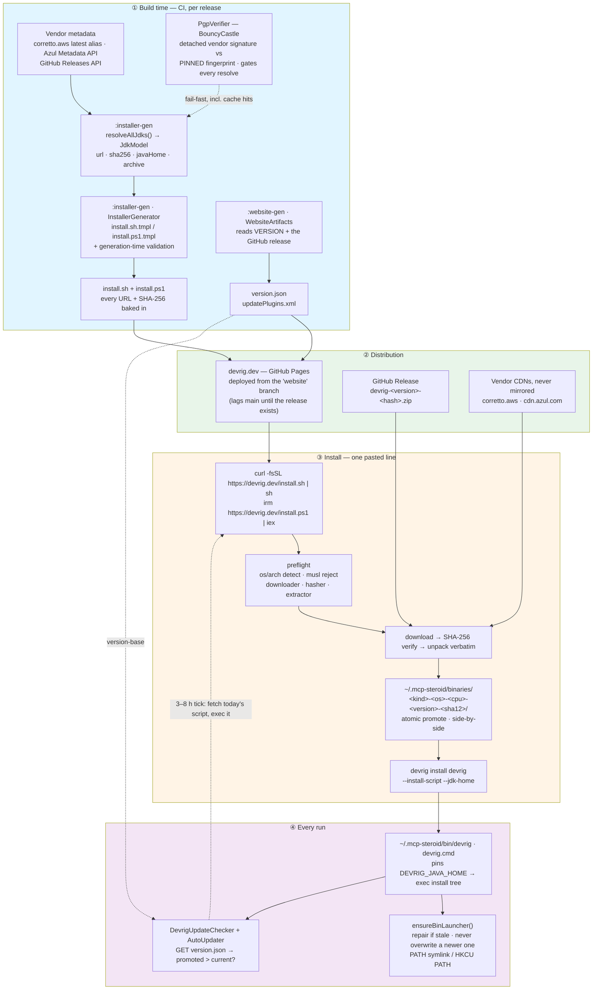

# Install, Launch, Update: Shipping a CLI on Five Platforms — the devrig Approach

**Date:** August 06, 2026  
**Author:** Eugene Petrenko  
**Tags:** devrig, mcp-steroid, cli, jvm, kotlin, distribution, open-source, ai-agents, ai-coding

---

**TL;DR** — This post is about an approach to making CLI tools installable and upgradable: one pasted line
installs the tool on five platforms, and after that it keeps itself current. The recipe: generate the install
script at build time with every URL and SHA-256 baked in, install versions content-addressed and side-by-side,
let the binary own the launcher on your `PATH`, and define "update" as "run today's install script" — so update
logic never ages with old installs. Built for `devrig`, a JVM CLI where the runtime is bigger than the program,
but most of it applies to any CLI you distribute yourself.
{: .notice}

Writing a command-line tool on the JVM is a pleasant afternoon. Kotlin, a `main`, a few subcommands,
`./gradlew installDist`, done.

Shipping it to a stranger is the hard part. That stranger is on Windows on ARM, or on a Mac that has never
had a JDK, or inside a container that turns out to be Alpine. They paste one line from your website into a
terminal, and whatever happens next is your product's first impression. In three weeks you ship an update, and
every one of those machines has to get there without you.

We hit this wall with [`devrig`][devrig-doc], the CLI that bridges AI Agents to IntelliJ-family IDEs in
[MCP Steroid][mcp-steroid]. When I wrote about `devrig` reaching
[Level 3 autonomy](), the honest "cons" list
opened with this:

> **JDK 25 is a hard requirement.** `devrig` doesn't bundle a JVM in 0.100; the host must provide
> Java 25.

Open question #3 in that same post was *"Bundled-JRE devrig: ship a `~/.mcp-steroid/binaries/<os>-<cpu>-<sha>/`
cache with a small wrapper, so the JDK-25 prerequisite stops being a prerequisite."* This post is what that
turned into: not a bundled JRE, but a small distribution system, and the interesting part is how little of
it lives inside the product.

The first generation of `devrig` ([`jonnyzzz/old-devrig-private`][old-devrig], still public) was written in
**Go** — a single static binary, nothing to provision — and its bootstrap script was still 182 lines of
POSIX `sh`. Everything below exists because we moved to Kotlin and inherited the JVM's one real
distribution problem: the thing that runs your program is bigger than your program. If you read one section,
read [the updater that cannot age](#the-updater-that-cannot-age) — the idea the rest exists to support.

One note on vintage, because this post mixes two. Quoted scripts and on-disk paths are the **released
devrig** — you can `curl` them yourself and check every hash against my directory names. Where `main` has
since moved on, I say so and name the issue. The gap between those two is where most of the interesting
mistakes live.

* TOC
{:toc}

## The problem, stated properly

The whole job in one sentence; every clause hides a trap.

> Deliver a reusable JVM command-line tool to five platforms, with a runtime the user does not have,
> installed by one pasteable line, updatable without breaking a running copy, and reproducible enough
> that you can tell a security team exactly what got executed.

Concretely: `macos-arm64`, `linux-x64`, `linux-arm64`, `windows-x64`, `windows-arm64`. Two script languages
(POSIX `sh` and PowerShell), two archive formats, two JDK vendors, one binary. Every obvious answer is wrong
in a way you only discover on someone else's laptop.

### "Just require a JDK on PATH"

Where `devrig` 0.100 was, and the most defensible wrong answer: it cost us more support time than every
other issue combined. `JAVA_HOME` points at a JDK 17 the user forgot about. The shell that launches an AI
Agent has a different `PATH` than the shell the user tested in. And "please install Java 25 first" is a
hostile first step for a tool whose pitch is *removing* setup steps.

### "Publish to Homebrew, apt, winget, Chocolatey, Scoop"

Only wrong as a *first* channel. Five package managers means five review processes, five release lags and
five sets of packaging conventions — a part-time job for a project releasing every few weeks — and the
versions drift, so you end up debugging a bug that exists only in one downstream package. Not worthless: a
package manager would hand us uninstall, proxy configuration, enterprise policy and inventory, four things
this post later admits we have not solved. A desirable second channel; not a viable first one.

### "`curl | sh` and figure it out at install time"

The natural install script asks the network what to install: the GitHub API for the latest release, the JDK
vendor for the current build, resolve URLs, download. It demos well. Then: GitHub's unauthenticated API
rate-limits you to 60 requests per hour per IP, so a whole office behind one NAT fails at once. A vendor
changes a URL shape and every historical install line breaks retroactively. Two users running the one-liner
an hour apart get different versions with no way to tell. And you cannot answer "what exactly did that
script download?" — the answer was decided at runtime, on their machine, by a server you do not control.

### "Install over the previous version"

Overwrite the install directory and you have a window where the tree is half old and half new. If a copy is
running — and for an MCP server bridging an AI Agent to an IDE, a copy is *always* running — you have just
swapped its files underneath it. Rollback means re-downloading the old version, which you did not keep.

### "Put all the update logic inside the binary"

The tempting one: `devrig self-update` checks a version endpoint, downloads, swaps, restarts. The problem is
subtle and expensive: **your update logic ages with the oldest installed copy.** A machine running 0.99
updates using 0.99's updater. If that updater had a bug, or predates the archive format you switched to, or
hardcodes a URL you retired, that machine is stranded — the only code that could fix it is the code that is
broken. A bootstrap problem discovered exactly once, in public. That failure mode shaped everything below.

## The architecture

Our answer inverts the usual layering: the install script is a **generated, self-contained artifact**, not a
thin wrapper around a smart product, and the product's only job on the install path is to register its own
launcher. Four ideas carry the design:

1. **Resolve at build time, not install time.** Every URL and SHA-256 for every platform is computed in CI
   and baked into the script, which detects *your* platform and *your* tools but never asks a server what
   to install.
2. **Content-address everything.** Each artifact unpacks into `<kind>-<os>-<cpu>-<version>-<sha12>/`, so
   two versions cannot collide: installs are side-by-side and re-installs free.
3. **The binary owns its launcher.** The script never writes the thing on your `PATH`; it hands off to
   `devrig install devrig`, and the binary re-checks and repairs that launcher on *every* start.
4. **Update is install.** Upgrading is running the current install script, so upgrade logic is always the
   newest code, never the oldest. When we later automated updates, the in-binary updater's whole job stayed
   "download today's script and exec it".

Here is the whole system (click to zoom)



*The diagram is dense by design — **click it** to open full-screen at readable size (Esc closes), or zoom the
page in.*

Now the parts, one at a time.

## The JDK data model: resolved live, PGP-verified, nothing hand-pinned

`:installer-gen` is a build-tooling Gradle module with no IntelliJ dependencies. Its
[`resolveAllJdks(cache, http)`][f-jdkmodel] produces a `JdkModel` — one `JdkArtifact` per platform, every field
*computed* from the live vendor source:

* **Amazon Corretto 25** for `linux-x64`, `linux-arm64`, `macos-arm64`, `windows-x64` ([`CorrettoJdk.kt`][f-corretto]):
  `HEAD` the vendor's `latest` alias, record where it redirects, pull the version out of the resolved URL.
* **Azul Zulu 25** for `windows-arm64` ([`AzulJdk.kt`][f-azul]) — the one platform Corretto does not publish — via
  the Azul Metadata API with `latest=true&release_status=ga`.

The *major* version is pinned in source; the patch level is not. "Latest 25" is resolved on every run,
because a pinned `25.0.4.7.1` in source is a lie that rots quietly and the generator's *output* is fully
pinned anyway.

`javaHome` is the field that breaks naive implementations. Every vendor lays out its archive differently —
`amazon-corretto-25.jdk/Contents/Home` on macOS, `jdk25.0.4_7` on Windows,
`zulu25.36.15-ca-jdk25.0.4-win_aarch64` for Azul — so it is not guessed from a convention: the model
streams the archive entries and **takes the shallowest `bin/java[.exe]`**, which is also proof against
archives nesting a `jre/bin/java` inside. Archives are downloaded and cached, never extracted.

Then the part that matters most:

> Both vendors publish detached OpenPGP signatures. The signing key **fingerprint is pinned in source**
> and asserted before the signature is trusted — and the key itself is fetched live over HTTPS, so the
> pin is what defeats a compromised key endpoint.

[`PgpVerifier`][f-pgp] (BouncyCastle `bcpg-jdk18on`) checks Corretto's `<file>.sig` and Azul's `signature-binary`
against constants that live in the source:

```kotlin
const val CORRETTO_KEY_FINGERPRINT = "6dc3636dae534049c8b94623a122542ab04f24e3"
const val AZUL_KEY_FINGERPRINT     = "27bc0c8cb3d81623f59bdadcb1998361219bd9c9"
```

It also insists the signature is a `PGPSignature.BINARY_DOCUMENT`, and on a mismatch refuses with
*"refusing to trust the signature (possible compromised key endpoint)"*. It is **fail-fast and runs on
every resolve, including cache hits** — the cache directory is shared, and a cache is not a trust boundary.
The cache is built the same way: `downloadWithEtag` **fails the build if the host exposes no `ETag`**, and
`downloadVerifyingSha256` re-hashes on every return.

## The generator: a template, a table, and a refusal to guess

[`InstallerGenerator`][f-gen] does something unglamorous: it renders two text templates.

```
installer-gen/src/main/resources/templates/install.sh.tmpl
installer-gen/src/main/resources/templates/install.ps1.tmpl
```

The templates hold all the *logic*; the generator injects only the *data* — `@@VERSION@@`,
`@@DEVRIG_URL@@`, `@@DEVRIG_SHA256@@`, `@@DEVRIG_BINSUB@@`, and the per-platform JDK table
(`@@PLATFORM_CASE_SH@@` as POSIX `case` arms, `@@PLATFORM_TABLE_PS@@` as a PowerShell hashtable). Only the
three POSIX platforms go into the `sh` table, only the two Windows ones into the PowerShell table;
`@@DEVRIG_BINSUB@@` is filled with a *different* value per template (`bin/devrig` vs `bin/devrig.bat`). If
any `@@PLACEHOLDER@@` survives rendering, generation fails.

What matters is what it refuses to do:

* **All five platforms or nothing.** `validateScriptTable` requires exactly `ALL_PLATFORMS`; missing *and*
  extra platforms both fail the build.
* **Shell-safety validation on vendor-controlled strings.** URLs and `javaHome` values are baked verbatim
  into single-quoted shell and PowerShell literals in a script people run via `curl | sh`, where a quote,
  backtick, `$`, backslash or control character would break out of the string:

  ```kotlin
  private val SHELL_UNSAFE_CHARS = charArrayOf('\'', '"', '`', '$', '\\')

  private fun requireShellSafe(label: String, value: String) =
      require(value.none { it in SHELL_UNSAFE_CHARS || it.isISOControl() }) {
          "$label contains a shell-unsafe character: '$value'"
      }
  ```

  It runs on every URL, every `javaHome`, the devrig URL, both launcher subpaths and the version string.
  Today's vendor values are clean; the check exists so a vendor URL change or a crafted archive entry name
  cannot produce an injectable installer, and *generation time* is the only place a human still sees the
  failure.
* **The launcher path inside the zip is discovered, not assumed.** The obvious guess is
  `devrig-<version>/bin/devrig`, but the real top-level directory carries the build hash —
  `devrig-0.101-40690055` — so `devrigLaunchers()` scans the actual archive entries for `*/bin/devrig` and
  `*/bin/devrig.bat` and *asserts* they exist. The devrig zip itself is resolved from the `v<version>`
  GitHub release, deliberately **not** `latest`, and the archive's top directory must start with
  `devrig-<version>-`.
* **ASCII-only output.** Both rendered scripts are scanned and rejected if any character is ≥ 128.
  PowerShell 5.1 misreads BOM-less UTF-8, and legacy Windows consoles corrupt Unicode. A tidy `→` in a
  log message is not worth a broken install on Windows 10

And one seam that matters more than it looks:

```kotlin
fun writeInstallerScripts(outDir: Path, table: Map<String, JdkScriptEntry>,
                          devrig: DevrigEntry, version: String)
```

`writeInstallerScripts` is pure — no network, no vendor lookups — so tests can render a *real* installer
from a *synthetic* model pointing at local fixtures. That is why end-to-end installer tests run in seconds
instead of downloading 200 MB JDKs.

## The generated script: what a good `curl | sh` looks like

The live one is [`https://devrig.dev/install.sh`][install-sh]: 207 lines, starting with a note that it is
generated. Every design choice in it exists because something broke.

**The whole body is a function, invoked on the last line.**

```sh
main() {
  ...
}

main "$@"
```

`curl | sh` streams into a shell that executes as it reads, so a connection dropped at 60 % executes 60 %
of your installer — a half-configured machine with no error message. Wrapping everything in `main()` called
at the very end makes a truncated transfer a no-op: the highest-value line in the file.

**Platform detection, then a hard stop on musl.** `uname -s` and `uname -m` detect and normalize the
platform, and `DEVRIG_OS` / `DEVRIG_CPU` override both, which is how the tests drive every platform arm. MCP
Steroid drives IntelliJ IDEs, which need glibc, so Alpine is not a platform we can serve: the script detects
musl three ways — `ldd --version` output, `/lib/ld-musl-x86_64.so.1`, `/lib/ld-musl-aarch64.so.1` — and
fails *before any download*, with a message that says why.

**Preflight, and a promise never to install packages.**

```sh
have_any curl wget        || add_missing 'curl (or wget) - to download files'
have_any sha256sum shasum || add_missing 'sha256sum (or shasum) - to verify downloads'
```

If anything is missing, the script prints the complete list plus the `apt-get` / `apk` / `dnf` / `brew`
lines — all four, unconditionally, because guessing a distro badly is worse than printing an extra line —
and stops. It never installs system packages on your behalf: a tool that `sudo`s during install has lost the
argument about trust before it starts.

`install.ps1` has no equivalent preflight and does not need one: `Invoke-WebRequest`, `Get-FileHash` and
`Expand-Archive` are built in. It also has no `main()` wrapper — `irm | iex` parses the whole string before
executing any of it, so truncation safety comes free. Two asymmetries that look like oversights until you
ask why.

**Content-addressed install, with an atomic promote.**

```sh
ia_sha12=$(printf '%s' "$ia_sha" | cut -c1-12)
ia_target="$BINARIES_DIR/${ia_kind}-${key}-${VERSION}-${ia_sha12}"
if [ -d "$ia_target" ]; then
  log "already installed: ${ia_target##*/}"
  printf '%s\n' "$ia_target"; return 0
fi
```

Download to `.tmp.$$.…`, verify SHA-256, unpack into a staging directory, then `mv` the finished tree into
its final content-addressed name, so a reader only ever sees a complete tree. `promote_tree` tolerates
*losing* that move — two installers running concurrently is not theoretical, an agent swarm does it
routinely — and since the target name comes from the archive's hash, whoever won unpacked the same archive,
so "someone beat me to it" is a success, not a conflict. There is no lock anywhere in this path; content
addressing makes one unnecessary. The PowerShell peer needs one extra clause: unlike POSIX `mv`,
`Move-Item` *nests* the source into an existing destination directory instead of failing, so it detects and
cleans the nested result.

**Everything goes to stderr**, via one `log()` helper. `devrig` speaks MCP over stdio, and a single stray
byte on stdout corrupts the protocol frame — the agent then reports an unexplained handshake failure.
[`Main.kt`][f-main] takes the rule to its conclusion: stdout is redirected to stderr before arguments are parsed, and
restored only for non-MCP commands. An invariant that has to hold in the *shell*, not just in the code.

### The PowerShell twin, and why it is not a translation

[`install.ps1`][install-ps1] is generated from the same model and mirrors the same pipeline, but its
comments read like a field report. Two examples that were real, user-facing bugs:

* **`$ProgressPreference`** ([#274][issue-274]). PowerShell's progress bar redraws on every byte
  `Invoke-WebRequest` reads and every entry `Expand-Archive` unpacks, turning a multi-hundred-MB download
  into a UI-bound crawl. The script silences it — and because `irm | iex` runs *in the caller's scope*, it
  saves the previous value and restores it in a `finally`.
* **Architecture detection** ([#273][issue-273]). `[RuntimeInformation]::OSArchitecture` does not exist on
  the .NET Framework 4.6.x that ships with base Windows 10, and under `Set-StrictMode -Version Latest` a
  missing property is a *hard abort*: a user ran `irm | iex` and got "OSArchitecture cannot be found on
  this object". The fix reads `PROCESSOR_ARCHITEW6432` first (WoW64 sets `PROCESSOR_ARCHITECTURE=x86` on
  64-bit Windows but exposes the true arch there), then `PROCESSOR_ARCHITECTURE`, and only then falls back
  to the .NET property, inside a `try`.

It also pins `[Net.ServicePointManager]::SecurityProtocol` to TLS 1.2 explicitly, because PowerShell 5.1
does not necessarily negotiate it. Both scripts close the child's stdin explicitly — `< /dev/null` in `sh`,
`$null |` in PowerShell — because a subprocess that inherits the bootstrapping shell's stdin and decides to
prompt will hang forever.

## Content-addressed, side-by-side installs

The on-disk layout does most of the work:

```
~/.mcp-steroid/
├── bin/
│   └── devrig                                    # the stable launcher on your PATH
└── binaries/
    ├── devrig-macos-arm64-0.101-a7c8cf0d16e2/    # <kind>-<os>-<cpu>-<version>-<sha12>
    │   └── devrig-0.101-40690055/bin/devrig      #   <- the zip's own top dir: version + git hash
    └── jdk-macos-arm64-0.101-614107ed76e9/
        └── amazon-corretto-25.jdk/Contents/Home
```

That `a7c8cf0d16e2` is the first 12 hex characters of the SHA-256 of the *downloaded archive* — the same
value that appears as `DEVRIG_SHA256` in the install script. You can verify the claim from your own shell,
which is the point.

The `0.101` in the *JDK* directory name is a bug, and we shipped it. Both artifacts got stamped with the
devrig release version, so a Corretto 25.0.4 tree ended up in a directory labelled `0.101`. It survived
review because there is a story you can tell about it — "the directory records which release chose this
JDK" — and that story is wrong: two consecutive releases pinning the *same* Corretto build download and
store it twice, and the name lies about its contents. [#362][issue-362] fixed it; each artifact now carries
its own vendor-native version, and the integration test pins a JDK version deliberately different from the
devrig version so the two can never silently re-merge. A plausible rationalization is the most expensive
kind of comment.

What the naming buys: the target directory existing *is* the "already installed" check, so re-running the
one-liner on a current machine touches the network only for the script itself; 0.101 and 0.102 have
different names, so a new install cannot touch an old one and a running process keeps its files, which makes
rollback a path edit rather than a download; and the unpack is verbatim — no `--strip-components`, no
rearranging, which is why `javaHome` has to ride along in the baked table. The weak spot is that the check
is *directory existence*, not content: a tree a user edited, or one a half-finished `rm -rf` left behind, is
trusted forever. A sentinel file recording the full hash would fix that cheaply and does not exist yet.

The honest cost: **nothing garbage-collects old versions.** Every upgrade leaves a full devrig tree and a
full JDK behind — the 0.101 devrig zip alone is 237 MB, most of it the bundled IDE plugin. And the naming
scheme is **not parseable by splitting on `-`**, because the version segment can itself contain a hyphen
(`0.0.0-test`, in the tests), so the GC has a parsing problem before it even reaches a policy problem. The
v7 deployment spec designs the sweep, with a keep-set of current plus most-recent-previous and per-directory
locks; none of it is implemented. Retention is only safe once you know nothing points at a tree, and the
whole point of content addressing was to not track that.

## The handoff: the script does not write the launcher

The install script does **not** create `~/.mcp-steroid/bin/devrig`, does not touch `PATH`, does not edit
shell profiles. Its last real action is:

```sh
DEVRIG_JAVA_HOME="$jdk_home" "$launcher" install devrig \
    --install-script="$launcher" --jdk-home="$jdk_home" < /dev/null \
  || fail "'devrig install devrig' failed - the launcher could not register itself"
```

It runs the freshly-unpacked binary and asks *it* to register itself. Note the variable: the handoff runs
under `DEVRIG_JAVA_HOME`, **never** by setting the user's `JAVA_HOME` — process-scoped, so the user's
environment is untouched. (The 0.101 script still uses `JAVA_HOME`; the contract below fixed it, and there
is a test pinning it.) The two flags are belt-and-braces: devrig accepts them and can equally derive both
paths itself, which is what it does on every later start.

Why give up that responsibility? Because **the shape of the launcher is product knowledge, and it changes.**
Adding a pathing JAR to work around Windows' "input line is too long" limit changed what the launcher must
contain. Had the install script owned it, every existing machine would carry a stale launcher written by
whichever installer version happened to run there, and fixing it would mean asking users to re-run an
installer. Because the *binary* owns it, the fix shipped with the binary and applied itself on the next
start.

What the installer must *not* do is a written, locked document —
[`docs/install-scripts-contract.md`][f-contract], titled *"install devrig, register PATH — nothing else"*.
Two prohibitions: never auto-register `devrig` with an AI Agent, because that edits Claude's / Codex's /
Gemini's own config files, state outside `~/.mcp-steroid` that belongs to the user; and never auto-install
the MCP Steroid plugin into an IDE. Both stay explicit — `devrig install <agent>`, `devrig install plugin`.
Instead the flow **promotes** them: `devrig install devrig` ends by listing the exact commands you may run
next, and the scripts print no next-steps block of their own, so guidance cannot drift as the command set
changes. Writing that down as a contract rather than leaving it as taste turns "should the installer wire up
my agent?" into a closed question: an installer that silently rewires your tools turns a "download this CLI"
decision into a "modify my agents" decision you never made.

## The launcher, and self-healing on every start

`~/.mcp-steroid/bin/devrig` on my machine, in full:

```sh
#!/bin/sh
# devrig launcher — managed by the devrig binary. Writes nothing to stdout (MCP stdio channel).
# Pins the JDK devrig runs under via DEVRIG_JAVA_HOME (its supported runtime), then hands off to
# the install-tree devrig launcher.
DEVRIG_JAVA_HOME="/Users/jonnyzzz/.mcp-steroid/binaries/jdk-macos-arm64-0.101-614107ed76e9/amazon-corretto-25.jdk/Contents/Home"; export DEVRIG_JAVA_HOME
exec "/Users/jonnyzzz/.mcp-steroid/binaries/devrig-macos-arm64-0.101-a7c8cf0d16e2/devrig-0.101-40690055/bin/devrig" "$@"
```

Six lines, three of them comments — the entire user-facing surface of the installation. The JDK pin answers
"which Java does it run under?": not the user's `PATH`, not their `JAVA_HOME`, but the runtime it shipped
with. On `main`, after 0.101, the header gained two machine-parseable lines —
`# devrig launcher version:` and `# devrig launcher source:` — for a reason we get to in a moment.

The Windows peer is `~/.mcp-steroid/bin/devrig.cmd`, same shape:

```bat
@echo off
set "DEVRIG_JAVA_HOME=<jdk home>"
call "<install tree>\bin\devrig.bat" %*
```

Deliberately **no PowerShell at launch** — a unit test asserts the generated launcher does not contain the
string. The first generation used a `devrig.bat` that trampolined into a `devrig.ps1`, and paying
PowerShell startup on every agent call is the mistake that taught us not to. `DEVRIG_JAVA_HOME` works
because the build patches Gradle's own start-script templates in `startScripts.doLast`, injecting a
`JAVA_HOME` override ahead of Gradle's "Determine the Java command" marker, under a `require(...)` that
fails the build if Gradle ever moves that marker.

[`BinLauncher.ensureBinLauncher()`][f-binlauncher] runs on **every** devrig start and makes sure, first, that the launcher
exists and points at devrig's *own* current install tree and the JDK it is *currently* running under — so
it self-heals if it was deleted, or went stale because an upgrade landed a new tree; and second, that the
launcher is reachable on `PATH`: on POSIX by symlinking it into the first `PATH` directory that is both
writable and under `$HOME` (pure Java, no subprocess), on Windows by registering the bin directory in the
HKCU user `PATH`, gated by a `bin/.user-path-registered` marker file. Windows needs a PowerShell helper for
exactly one reason: pure Java cannot *persist* a user `PATH` entry, only check membership.

**And here is the part that "rewrite on every start" gets wrong if you stop there.** Two versions coexist
by design, so the moment an *older* devrig starts — an agent still holding a stale registration, a session
that outlived an upgrade — it would happily rewrite the launcher backwards, and the newest install would
lose. [#373][issue-373] is the guard: the launcher carries its writer's version in that header line, and
`shouldKeepNewerLauncher` refuses to overwrite a launcher stamped strictly newer than the running build
(SNAPSHOT counts as newest). A kept-newer launcher still gets its `+x` bit repaired. Self-healing without
that check is not self-healing, it is a race — and it took shipping side-by-side installs to see it.

The rest is other people's edge cases:

* `writeIfChanged` compares against the intended content, normalizing CRLF/LF and a trailing newline, and
  returns early when they match — but still repairs a lost `+x`.
* A real write stages to a sibling `<name>.new<pid>`, `chmod +x` *before* the move, then moves atomically.
  If that is blocked — Windows holding the launcher open — it renames the original to `<name>.old<pid>`,
  which NTFS permits on an open file, moves again, and deletes the old one; five attempts, 10 ms apart.
  Crash leftovers are never swept: a stray `.old1234` is cheaper than a sweeper that could delete a live
  launcher.
* `DEVRIG_BIN_NO_AUTO_REGISTER` is an undocumented opt-out, and self-registration defaults to *off* for
  `SNAPSHOT` builds so a local dev build never clobbers a real launcher; an explicit `devrig install`
  forces it regardless. The whole thing is best-effort — failing to heal the launcher must never take down
  `devrig mcp`.

Whatever you typed to launch it, you end up pointing at the one stable launcher. That is the invariant, and
it is why agent registrations point at `~/.mcp-steroid/bin/devrig` and survive every upgrade without being
rewritten.

## Update: the updater that knows nothing

`:website-gen` publishes a `version.json` next to the scripts. It is not a manifest:

```json
{"version-base":"0.101"}
```

One field — what version is promoted right now. [`DevrigUpdateChecker`][f-updatechecker] fetches it with a cache-busting query
and 10-second timeouts, and when a newer version exists it writes to stderr *and* pushes an MCP
`notifications/message` so the agent sees it too. Any failure returns `null` and is swallowed at debug
level: an update check must never be able to break a run. The same endpoint serves the in-IDE plugin's
checker, which adds an `?intellij-version=<build>` query so the answer can be build-aware.

Comparing versions deserved its own type. The first version compared strings by prefix, which is how we got
[#360][issue-360]: our release tags and our CI tags were not mutually orderable, so either could look like
an update to the other. [`DevrigVersion`][f-version] now implements `Comparable` with two product rules — a `SNAPSHOT`
build sorts above anything promoted, and build metadata after the first `-` carries no precedence, so
`0.86.0-a1b2c3d` does not rank below `0.86.0` — and the decision is a plain
`isUpdateAvailable(current, promoted) = promoted > current`, which also means a *downgrade* is not an
update.

### And then the upgrade is: run the install script again

Everything above is what makes that sentence sufficient —

* the script is regenerated per release, so it always carries the *current* URLs and hashes;
* installs are content-addressed, so a new version lands beside the old one instead of over it;
* the binary owns the launcher, so the new binary repoints it on its first start;
* agent registrations point at the stable launcher path, so nothing needs re-registering;
* the script is idempotent, so running it when you are already current prints `already installed` and
  downloads nothing.

For 0.101 — the release you get if you run the one-liner today — that is the whole story: `devrig` tells
you, you re-run the line. And then we shipped the obvious next step, and the shape of it is the reason this
post exists.

### The updater that cannot age

[`AutoUpdater`][f-autoupdater] is merged on `main` and not in 0.101 — install today and you get the
notify-only behaviour above; the next release turns this on. It does genuinely self-update, and here is the
interesting part of it:

```kotlin
val scriptUrl = if (isWin) "https://devrig.dev/install.ps1" else "https://devrig.dev/install.sh"
```

That is the entire update algorithm: download today's install script, run it, supervise it. There is no
archive handling in the binary, no URL construction, no hash table, no unpack logic, no launcher
rewriting — **none of the artifact knowledge that goes stale.** The parts that rot fastest live in a file
fetched fresh from the website seconds before it runs.

The title oversells slightly, so let me undersell it: the binary still hardcodes the two script URLs, the
OS branch, the process-spawning and timeout behaviour, the marker protocol, and the version semantics. A
real aging surface — just a small, slow-moving one, and none of it is the part that changes when a vendor
moves a URL or we switch an archive format.

Which answers the objection from the top of this post. "Put the updater inside the binary" fails because
*your update logic ages with the oldest installed copy.* The escape is not to refuse to self-update, it is
to make the in-binary part contain no logic to age. A machine that sat on 0.99 for a year does not upgrade
using 0.99's ideas about archive formats or vendor URLs; it upgrades using today's, because all 0.99 knows
how to do is fetch and exec.

What is *around* that one line is the part I underestimated:

* **Scheduling — and only where it is safe.** The active updater runs *only* in `devrig mcp` sessions: it
  ticks, then sleeps `Random.nextLong(180, 481).minutes` — 3 to 8 hours, jittered so a fleet does not
  stampede the CDN — and repeats forever. A short one-shot command keeps the passive notice and never
  spawns an installer. Nobody's `devrig --version` should turn into a 200 MB download.
* **Multi-process coordination**, because on this machine six agents routinely each hold a `devrig mcp`.
  [`UpdateCoordination`][f-updatecoord] writes an `update-<pid>-version-<v>` marker under `~/.mcp-steroid/update/`, then
  **re-checks after announcing** and yields if a lower pid is also in progress. Lowest pid wins; losers
  exit silently. An `updated-<v>` marker means "already installed here" and turns the tick into a restart
  notice, once per process.
* **Supervision.** The installer is spawned detached with a one-hour timeout and its own per-pid log file.
  On Windows it prefers `powershell.exe` by absolute System32 path, falling back to whatever `powershell`
  or `pwsh` is on `PATH`.
* **No retry cap, deliberately.** Too many transient root causes exist, and the goal is to keep users
  current, so every failure retries on the next 3–8 hour tick, forever. Diagnosis lives in stderr and the
  log files rather than in a state machine.
* **Never downgrade**, and the marker GC is bounded below `min(current, promoted)` so a session running
  *newer* than the promoted version — what a rollback looks like — cannot delete records older sessions
  still need.
* **Three ways off.** SNAPSHOT builds skip the whole thing, and either `DEVRIG_NO_AUTO_UPDATE` or the
  launcher-write opt-out `DEVRIG_BIN_NO_AUTO_REGISTER` disables it.

Two things I would still flag. `version.json` is **unsigned**, and it just stopped being advisory: that one
field now decides whether a script is downloaded and executed. And nothing pins a *session* to a version —
the update repoints the shared launcher, so the next thing an agent launches is the new binary, mid-task.
"The fleet finishes on the version it started with" is a property we describe and do not yet enforce.

## Distribution, and the release-ordering trap

The scripts and `version.json` are static files on GitHub Pages at [devrig.dev][devrig-site] — one
canonical host, with the older `mcp-steroid.jonnyzzz.com` 307-redirecting to it rather than serving a
second copy, and the code (both update checkers, both install scripts) pointing at the canonical
name. `:website-gen`'s `generateWebsite` task depends on `:installer-gen:generateInstaller` and writes
`version.json`, `updatePlugins.xml`, `install.sh` and `install.ps1` into `website/build/generated-static`,
which Hugo folds into the site root. Nothing generated is committed. The binaries live on the GitHub
Release; the JDKs are never mirrored — users download them straight from the vendor.

The non-obvious component here is a *branch*. The site does not deploy from `main`:

> Deploy from the long-lived `website` branch, NOT `main`. `website` tracks `main` but can deliberately
> lag it so website changes that depend on an UNRELEASED devrig binary — e.g. a new `install.sh` /
> `install.ps1` contract — stay off the live site until a matching GitHub release exists.

The install script's content depends on a GitHub release that does not exist until you publish it, and the
release notes point at an install script that must not go live early. Deploy from `main` and there is a
window — minutes or days — where `devrig.dev/install.sh` references a release tag that 404s, and every new
user in that window gets a broken install with no explanation. A separate deploy branch, fast-forwarded
*after* the release is published, closes it — as long as nobody advances the branch by hand out of order,
which is convention plus a release-readiness check, not a permission. The Pages workflow also rebuilds on
`release: published`, because generating `updatePlugins.xml` requires querying the release for its asset
URL.

The ordering constraint is worth stating as a sequence, because getting it wrong is how you serve a 404:

1. Build the artifacts and **publish the GitHub release** for `v<version>`. Nothing about the website has
   moved yet, so the live site still describes the previous release, correctly.
2. **Generate** — `:installer-gen:generateInstaller` resolves the devrig zip *from that release*, which is
   why the release has to exist first, and resolves the JDKs live from the vendors.
3. **Fast-forward `website` to `main`.** This is the deploy: Hugo folds in the generated `install.sh`,
   `install.ps1` and `version.json`, and the one-liner starts pointing at the new release in the same push
   that starts announcing it.
4. Only now does a `devrig` on someone's laptop see a new `version-base` and tell its user.

In between steps 1 and 3, `main` can carry an install script for a release that does not exist yet, and no
user is exposed to it.

## Signing: implemented once, designed twice, not shipped yet

The current chain of trust, hop by hop, with no softening:

1. **You paste a URL.** HTTPS to `devrig.dev` (GitHub Pages, behind a CDN). *Unauthenticated beyond
   TLS.*
2. **The script runs.** Its contents are whatever that host served. **Not signed.** Ask for
   `install.sh.asc` today and you get a 404.
3. **Artifacts download.** Each is checked against a SHA-256 baked into the script at generation time.
   *Strong — but only as strong as hop 2, since whoever can change the script can change the hashes.*
4. **The JDK hashes were earned.** At generation time the vendor JDK archives were OpenPGP-verified
   against fingerprints pinned in source, fail-fast, on every resolve including cache hits. *This part is
   real — with one honest asterisk: it protects the release engineer, not the user. None of that evidence
   travels to the machine, so a user cannot re-check it.*
5. **The devrig zip itself has no signature at all.** Its only credential is a hash written by the same
   unsigned script. The runtime we did not build gets stronger provenance than the binary we did, which
   is a funny thing to discover about your own pipeline.
6. **`version.json` is fetched on every run, and it is not signed.** Until recently the worst a tampered one
   could do was fake an update *notice*. Now it decides whether a script is downloaded and executed. That
   one unsigned field is the weakest thing in this post, and it got weaker the day auto-update shipped.

So the gap is hop 2, the classic `curl | sh` circularity: verifying a script before executing it requires
something already trusted on the machine.

**We solved this before, in the project's own prehistory.** The Go generation fetched
`https://devrig.dev/download/latest.json` with a `.sig` and verified it natively against **two embedded SSH
public keys** — one ed25519, one RSA-4096 — using `golang.org/x/crypto/ssh`, no `ssh-keygen` subprocess;
the release side had `ssh-sign.sh` and `sync-release.sh`. Its bootstrap script also re-verified the
binary's SHA-512 on *every* run, not just after download.

The current design, written up as v7 of `docs/devrig-deployment-spec.md` and marked *"design ready for
implementation"*, resolves the circularity rather than ignoring it: a `version.properties` manifest, a
`version.properties.signatures` file holding **two ed25519 SSH signatures**, and an `allowed_signers` file
in OpenSSH format pinning both public keys — **two keys, two operators, two machines**, both of which must
verify, so one compromised laptop is not enough. **Verification is Java-only**: the shell wrapper *fetches
and stores* the signatures and never checks them, and the installed binary verifies on upgrade. That is the
key move — the initial install is trust-on-first-use over HTTPS, and every subsequent update is
verified by code already installed and already trusted, so you stop trying to bootstrap trust from a pipe.
The manifest also carries a SHA for each wrapper script, so an upgrade can verify the *launchers* too, and
a weekly CI job `HEAD`s every URL in the manifest and spot-checks the SHAs, so a dead vendor URL fails a
build rather than a user's install.

None of that ships today. The honest one-line summary is *HTTPS, plus generation-time vendor PGP, plus
install-time SHA-256 — with the bootstrap hop unauthenticated, the promoted-version field unsigned, and a
worked-out design for closing both.* If you are evaluating this pattern for your own tool, that is the
sentence to weigh.

## Testing scripts and generators

Shell scripts and code generators are both famously untested, usually with the same excuse: "you'd need a
real machine". You need a container, and a seam.

**The seam** is [`writeInstallerScripts(outDir, table, devrig, version)`][f-gen] — network-free, wrapping a
`renderInstallerScripts` that touches neither network nor disk. A test hands it a synthetic five-platform
table pointing at a local HTTP server and gets a real installer out. Every lane below rests on it.

**Hermetic unit tests** (`./gradlew :installer-gen:test`) — no network at all; the URL-routing fakes
hard-error on anything they were not given:

| Test | What it pins down |
|--------------------------|--------------------------------------------------------------------------|
| [`InstallerGeneratorTest`][f-gentest] | 24 tests: placeholders all resolved, exactly-five-platform validation, ASCII-only, unsafe version strings, `resolveDevrig` version-mismatch |
| [`JdkArtifactsTest`][f-jdktest] | Vendor parsing, the shallowest-`bin/java` scan with a nested `jre` decoy, and *"expected 4 Corretto + 1 Azul"* as a hard assertion |
| [`PgpVerifierTest`][f-pgptest] | Tampered data, key-not-in-keyring, wrong pinned fingerprint, fingerprint matching that ignores case and spaces — against keys generated in-test |
| [`CacheTest`][f-cachetest] | Hash-mismatch rejection, **re-verification on a cache hit with a corrupted cache file**, and "must not download when caching can't be validated" for the missing-ETag case |

Two are worth stealing as a technique. The `$ProgressPreference` test does not assert the line is
*present*: it asserts it appears **exactly once, at an index before** both `Invoke-WebRequest -Uri` and
`Expand-Archive -Path`, and is *absent* from `install.sh`. The #273 test requires any `RuntimeInformation`
access to sit inside a *preceding* `try {`. Both encode the property that mattered, not the diff that fixed
it. Fingerprints are injectable into `resolveAllJdks` for the same reason — so the PGP tests can pin a
generated key.

**Docker integration lanes** ([`InstallerBootstrapTest`][f-bootstraptest] and its PowerShell peer, in a
separate `installerIntegrationTest` source set gated so a plain `./gradlew check` compiles but never runs
them):

* *"end-to-end on ubuntu (glibc)"* — a fake devrig zip and fake JDK tarball served by an **nginx side-car
  started first**, so the test learns its bridge IP and bakes those URLs plus the fixtures' real SHA-256s
  through the seam. In a digest-pinned Ubuntu image it then checks both downloads, SHA verified, trees at
  `devrig-linux-x64-0.0.0-test-<sha12>`, `bin/java` executable, the delegation carrying the exact
  `--install-script=` / `--jdk-home=` values, and **no agent registration** — then a second run asserting
  `already installed:` and zero downloads.
* *"refuses musl (alpine)"* — the real script in `alpine:3.21`: non-zero exit, the message explains musl,
  and the output **never contains "downloading"**, which proves the ordering rather than the wording.
* *the `pwsh` lane* — `mcr.microsoft.com/powershell:lts-7.4-ubuntu-22.04`, because Windows-native Docker is
  not something this CI provisions. `DEVRIG_OS` / `DEVRIG_CPU` stay unset so the real auto-detect branch
  runs, and the template *anticipates* it: a `bin/java` stub is accepted where `bin/java.exe` would be.

The best line in the suite is a constant: `INSTALLER_HOME_DIR = "/home/tester one"`. `HOME` with a space in
it. Every quoting bug in a shell installer dies there, permanently, for free.

**The native Windows lane.** A `pwsh`-on-Linux test cannot catch a PowerShell 5.1 / .NET Framework bug,
which is exactly what [#273][issue-273] was. So [`InstallerPs1ExecutionTest`][f-ps1exectest] runs the installer for real on
`windows-latest` under both `powershell.exe` (5.1) and `pwsh` (7.x), serving fixtures from an in-process
`com.sun.net.httpserver.HttpServer` (`Invoke-WebRequest` rejects `file://`), and asserts by *negative*: the
output must not contain `"The property 'OSArchitecture' cannot be found"`. [`InstallerScriptTest`][f-scripttest] adds a
cheap syntax gate — the PowerShell AST parser under 5.1, `sh -n` on Linux. Both lanes run on every branch
push, with TeamCity carrying the same suites internally.

`resolveAllJdks` leans on two vendor APIs that can change under you, so it is covered three ways:
hermetically over synthetic archives; by the fail-fast PGP check on every resolve, so a vendor serving
something unexpected fails the *build* and not a user's install; and by `generateInstaller` running for
real in the release pipeline. Tests that intentionally hit public vendor feeds are tagged live-network and
**excluded from the default test task**.

So: the scripts' *logic* is tested hermetically, their *behaviour* in real shells in real containers, their
*content* at generation time, and the one thing you cannot fake — Windows' own PowerShell — gets a dedicated
runner.

## Where this was built and tested

Everything above lives in [jonnyzzz/mcp-steroid][mcp-steroid]. The vendor endpoints, regexes and API field
names this post deliberately does not transcribe are all in these files:

* **The JDK model** — [`JdkModel.kt`][f-jdkmodel], [`CorrettoJdk.kt`][f-corretto], [`AzulJdk.kt`][f-azul],
  [`PgpVerifier.kt`][f-pgp], [`Cache.kt`][f-cache].
* **The generator** — [`InstallerGenerator.kt`][f-gen] and the two templates,
  [`install.sh.tmpl`][f-shtmpl] / [`install.ps1.tmpl`][f-pstmpl]. The templates are the installer; the
  generator is 300 lines of validation around them.
* **The CLI side** — [`BinLauncher.kt`][f-binlauncher], [`InstallCommand.kt`][f-installcmd],
  [`DevrigUpdateChecker.kt`][f-updatechecker], [`AutoUpdater.kt`][f-autoupdater]. In `devrig-common`:
  [`HomePaths.kt`][f-homepaths] (the layout, pinned by tests and deliberately not configurable) and
  [`UpdateCoordination.kt`][f-updatecoord] (the marker protocol).
* **The contracts** — [`docs/install-scripts-contract.md`][f-contract] (locked) and
  [`docs/updates-check/devrig-auto-update.md`][f-autodoc].
* **The tests** — [`InstallerBootstrapTest.kt`][f-bootstraptest] is the one to read. The Windows lanes live
  in `test-integration-agent-launch`.
* **The design doc** — [`docs/devrig-deployment-spec.md`][f-spec], v7, including the signing and GC work
  that is designed but unshipped. Its iteration history runs v1 → v7.
* **The prehistory** — [`jonnyzzz/old-devrig-private`][old-devrig], the Go generation: a per-project
  `.devrig` home, SHA-512 content addressing, re-verification on every run, and a `latest.json` update feed
  signed under two embedded SSH keys we have not yet re-adopted.

Almost none of the sharp edges above were found by design review. The Windows work exists because people
ran `irm | iex` and got an error message instead of a tool, then told us. The two open items on the JDK
model — folding the resolved URL into the cache key, tightening Azul's `latest` selection — came out of a
quorum review of that PR, not from the author. Distribution code is exactly the kind of thing where a
second and third reader pay for themselves, because the failure modes live on machines you do not own. One
more warning from the old generation: `IsUpdateAvailable()` there returned `info.Version == thisVersion`,
the inverse of what its own comment described, so it announced an update precisely when you were current.
Update paths need tests more than they need cleverness.

## What is not solved yet

The list I would want to read if I were evaluating this for my own project.

* **`version.json` is unsigned, and it now triggers code execution.** Top of the list. Everything else here
  is inconvenience; this one is a trust gap that auto-update promoted from theoretical to live.
* **The bootstrap hop is unauthenticated**, as laid out above. Design exists; implementation does not.
* **No session pinning.** An update repoints the shared launcher under a running fleet.
* **No garbage collection, and no uninstall.** Old trees accumulate forever; `devrig gc` does not exist.
  And between the launcher, a `PATH` symlink, an HKCU `PATH` entry, marker files, agent registrations and a
  few hundred MB per version, there is no supported way to remove any of it.
* **No rollback command, and no health-checked activation**, despite the design assuming rollbacks happen —
  the auto-updater's GC bound explicitly handles "a session running newer than the promoted version,
  post-rollback". A release that downloads and unpacks cleanly but fails to *start* still becomes the
  launcher's target, and rolling back means hand-editing two paths in `~/.mcp-steroid/bin/devrig`.
* **The signing design stops at the happy path.** Two keys and an `allowed_signers` file is the easy half.
  Rotation, revocation, recovery after a compromise, anti-replay for a signed-but-stale manifest, and a
  migration story for clients installed *before* a verifier exists are all unwritten. So is macOS
  notarization and Windows code-signing for the artifacts themselves.
* **No proxy or custom-CA story.** The one that bothers us most: the person we keep describing — corporate
  Windows box, no admin rights — is exactly the person behind a TLS-inspecting proxy. Neither script is
  documented as honouring `HTTPS_PROXY` or an enterprise root CA. `curl` and `Invoke-WebRequest` pick some
  of that up from the environment by accident; "by accident" is not a support answer.
* **No download retry or resume.** A transfer that dies at 80 % is a failed install and a re-run from zero,
  on a 200 MB JDK. The auto-updater's answer is "try again in 3–8 hours", which is fine for it and no help
  to a human watching a progress line.
* **Test gaps we know about.** `requireShellSafe` — showcased above as security-critical — has no test of
  its own. Nothing exercises the `wget` fallback. And `windows-latest` is Windows Server 2025 with a modern .NET,
  so the machine that actually broke in [#273][issue-273] — base Windows 10 with .NET Framework 4.6.x — is
  still not in CI.
* **Vendor drift is only caught at release time.** The weekly "HEAD every URL and re-check the SHAs" job is
  in the design, not in `.github/workflows`, so a vendor pulling a build is discovered by the next release
  or by a user. And because generation resolves live and the output is not committed, there is no retained
  record proving which coordinates a given release actually served — awkward for a post that opened by
  promising you could tell a security team exactly what got executed.
* **One user per machine.** `~/.mcp-steroid` is per-`$HOME` and explicitly not configurable — the
  plugin↔devrig marker contract pins the location. A shared CI box gets one installation.
* **Two vendors, five platforms.** No Temurin, no GraalVM, no Intel macOS, no musl. All deliberate, and all
  a real "sorry" to real people.

## Is this an open-source project on its own?

I think so, and I keep coming back to it because the *reusable* part is genuinely small. Strip out
everything MCP Steroid–specific and what is left is:

1. A JDK data model resolved live from vendor sources and PGP-verified against pinned fingerprints
   (~three files plus a cache).
2. A generator that renders two script templates from that model, with generation-time validation (one
   file plus the templates).
3. A convention: content-addressed side-by-side installs under a fixed home, with the *binary* owning
   the launcher, and "update" defined as "run the current install script".
4. A test harness: a pure render seam, an nginx side-car, three container lanes plus one native Windows
   runner, and a `HOME` with a space in it.

That is a plausible *toolkit* — call it *ship-your-jvm-cli*. Not a library yet: the binary-side half
(launcher registration, update supervision, version policy, multi-process coordination) is still welded to
this product, and a library has to offer those as APIs rather than as a description. And what makes the
generator half work is mostly **conventions and negative constraints** rather than code — the rules:
resolve at build time, verify vendor signatures at generation time, never let the script own the launcher,
make update mean install, and put everything the script prints on stderr.

Becoming a real project would mean pluggable artifact coordinates rather than "devrig on
`jonnyzzz/mcp-steroid` releases"; a configurable home, which conflicts with the marker contract that made
it fixed in the first place — a design argument, not a refactor; Temurin and GraalVM alongside Corretto and
Zulu; and a finished signing story.

If you have shipped a JVM CLI to strangers, I would like to compare notes — particularly on two things.
First, **signing a `curl | sh` bootstrap**: our *designed* answer is trust-on-first-use plus two-key
ed25519 verification for every update thereafter, and since it is designed rather than shipped, this is a
genuine question and not a humblebrag — has anyone done better without shipping a package manager?
Second, **retention**: how do you decide an old install tree is safe to delete, when the whole point of
content addressing was to never track what points at it?

Open an issue on [jonnyzzz/mcp-steroid][mcp-steroid], or reply on [LinkedIn][linkedin] or
[Twitter][twitter] — and if *ship-your-jvm-cli* is something you would actually use rather than nod at,
say so, because that is the only signal that would make us extract it

[mcp-steroid]: https://github.com/jonnyzzz/mcp-steroid
[devrig-site]: https://devrig.dev/
[devrig-doc]: https://mcp-steroid.jonnyzzz.com/docs/devrig/
[install-sh]: https://devrig.dev/install.sh
[install-ps1]: https://devrig.dev/install.ps1
[old-devrig]: https://github.com/jonnyzzz/old-devrig-private
[f-jdkmodel]: https://github.com/jonnyzzz/mcp-steroid/blob/main/installer-gen/src/main/kotlin/com/jonnyzzz/mcpSteroid/installer/JdkModel.kt
[f-corretto]: https://github.com/jonnyzzz/mcp-steroid/blob/main/installer-gen/src/main/kotlin/com/jonnyzzz/mcpSteroid/installer/CorrettoJdk.kt
[f-azul]: https://github.com/jonnyzzz/mcp-steroid/blob/main/installer-gen/src/main/kotlin/com/jonnyzzz/mcpSteroid/installer/AzulJdk.kt
[f-pgp]: https://github.com/jonnyzzz/mcp-steroid/blob/main/installer-gen/src/main/kotlin/com/jonnyzzz/mcpSteroid/installer/PgpVerifier.kt
[f-cache]: https://github.com/jonnyzzz/mcp-steroid/blob/main/installer-gen/src/main/kotlin/com/jonnyzzz/mcpSteroid/installer/Cache.kt
[f-gen]: https://github.com/jonnyzzz/mcp-steroid/blob/main/installer-gen/src/main/kotlin/com/jonnyzzz/mcpSteroid/installer/InstallerGenerator.kt
[f-shtmpl]: https://github.com/jonnyzzz/mcp-steroid/blob/main/installer-gen/src/main/resources/templates/install.sh.tmpl
[f-pstmpl]: https://github.com/jonnyzzz/mcp-steroid/blob/main/installer-gen/src/main/resources/templates/install.ps1.tmpl
[f-bootstraptest]: https://github.com/jonnyzzz/mcp-steroid/blob/main/installer-gen/src/installerIntegrationTest/kotlin/com/jonnyzzz/mcpSteroid/installer/tests/InstallerBootstrapTest.kt
[f-binlauncher]: https://github.com/jonnyzzz/mcp-steroid/blob/main/npx-kt/src/main/kotlin/com/jonnyzzz/mcpSteroid/devrig/BinLauncher.kt
[f-installcmd]: https://github.com/jonnyzzz/mcp-steroid/blob/main/npx-kt/src/main/kotlin/com/jonnyzzz/mcpSteroid/devrig/InstallCommand.kt
[f-updatechecker]: https://github.com/jonnyzzz/mcp-steroid/blob/main/npx-kt/src/main/kotlin/com/jonnyzzz/mcpSteroid/devrig/DevrigUpdateChecker.kt
[f-main]: https://github.com/jonnyzzz/mcp-steroid/blob/main/npx-kt/src/main/kotlin/com/jonnyzzz/mcpSteroid/devrig/Main.kt
[f-version]: https://github.com/jonnyzzz/mcp-steroid/blob/main/mcp-core/src/main/kotlin/com/jonnyzzz/mcpSteroid/util/text/DevrigVersion.kt
[f-homepaths]: https://github.com/jonnyzzz/mcp-steroid/blob/main/devrig-common/src/main/kotlin/com/jonnyzzz/mcpSteroid/devrig/HomePaths.kt
[f-updatecoord]: https://github.com/jonnyzzz/mcp-steroid/blob/main/devrig-common/src/main/kotlin/com/jonnyzzz/mcpSteroid/devrig/UpdateCoordination.kt
[f-gentest]: https://github.com/jonnyzzz/mcp-steroid/blob/main/installer-gen/src/test/kotlin/com/jonnyzzz/mcpSteroid/installer/InstallerGeneratorTest.kt
[f-jdktest]: https://github.com/jonnyzzz/mcp-steroid/blob/main/installer-gen/src/test/kotlin/com/jonnyzzz/mcpSteroid/installer/JdkArtifactsTest.kt
[f-pgptest]: https://github.com/jonnyzzz/mcp-steroid/blob/main/installer-gen/src/test/kotlin/com/jonnyzzz/mcpSteroid/installer/PgpVerifierTest.kt
[f-cachetest]: https://github.com/jonnyzzz/mcp-steroid/blob/main/installer-gen/src/test/kotlin/com/jonnyzzz/mcpSteroid/installer/CacheTest.kt
[f-ps1exectest]: https://github.com/jonnyzzz/mcp-steroid/blob/main/test-integration-agent-launch/src/test/kotlin/com/jonnyzzz/mcpSteroid/agentlaunch/InstallerPs1ExecutionTest.kt
[f-scripttest]: https://github.com/jonnyzzz/mcp-steroid/blob/main/test-integration-agent-launch/src/test/kotlin/com/jonnyzzz/mcpSteroid/agentlaunch/InstallerScriptTest.kt
[f-spec]: https://github.com/jonnyzzz/mcp-steroid/blob/main/docs/devrig-deployment-spec.md
[issue-273]: https://github.com/jonnyzzz/mcp-steroid/issues/273
[issue-274]: https://github.com/jonnyzzz/mcp-steroid/issues/274
[issue-360]: https://github.com/jonnyzzz/mcp-steroid/issues/360
[issue-362]: https://github.com/jonnyzzz/mcp-steroid/issues/362
[issue-373]: https://github.com/jonnyzzz/mcp-steroid/issues/373
[f-autoupdater]: https://github.com/jonnyzzz/mcp-steroid/blob/main/npx-kt/src/main/kotlin/com/jonnyzzz/mcpSteroid/devrig/AutoUpdater.kt
[f-contract]: https://github.com/jonnyzzz/mcp-steroid/blob/main/docs/install-scripts-contract.md
[f-autodoc]: https://github.com/jonnyzzz/mcp-steroid/blob/main/docs/updates-check/devrig-auto-update.md
[linkedin]: https://www.linkedin.com/in/jonnyzzz/
[twitter]: https://twitter.com/jonnyzzz